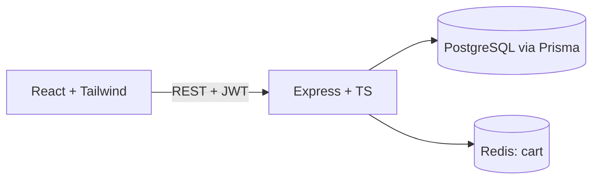

# Architecture

## Roles
customer: browse, cart, checkout, review, invoice | vendor: product CRUD, fulfil own order items | admin: analytics, coupons
## API
POST /auth/register, /auth/login | GET/POST /products, PUT/DELETE /products/:id | GET/POST /cart | POST /orders, GET /orders
GET /vendor/orders, PATCH /items/:id/advance | GET/POST /products/:id/reviews | POST /coupons | GET /orders/:id/invoice | GET /admin/analytics
## Payment split
Each OrderItem stores `commission` (COMMISSION_PERCENT, default 10%) and `vendorEarning`. Payment is a test-mode reference today; Stripe Connect transfers are the next step.
